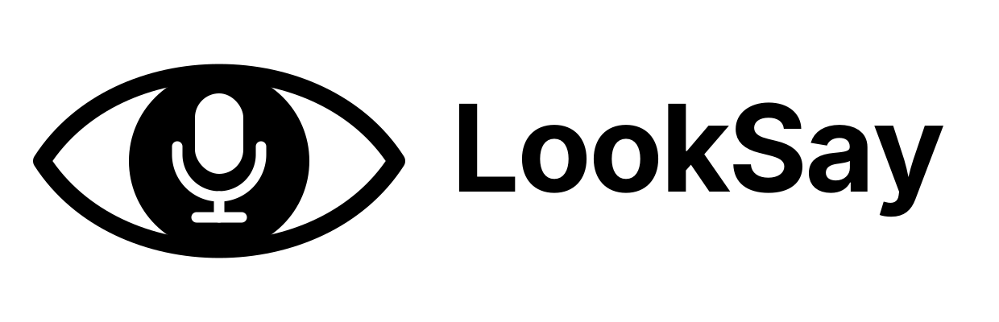
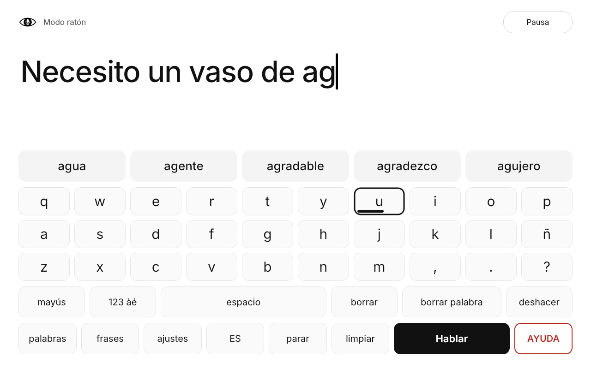

<p align="center"></p>

**LookSay** is an offline, eye-controlled communication app for people with
severe motor impairments, including tetraplegia. You look at keys to write a
message and LookSay speaks it aloud. It only needs a standard webcam. After
setup, no mouse, keyboard, account or internet connection is required.

## Screenshot

<p align="center"></p>

The screenshot is rendered from the real app with `python tools/screenshots.py`.

## Features

- Letter keyboard and word/phrase keyboard, with 3–6 large word predictions.
  Predictions run on the device and learn your vocabulary.
- Webcam eye tracking (MediaPipe face and iris landmarks), 5- or 9-point
  calibration, drift recentering, dwell selection with a visible progress bar,
  and optional blink-to-select.
- Selection pauses automatically when your face is lost or tracking
  confidence is low.
- Offline text-to-speech using your system's voices, editable quick phrases,
  and an always-visible **HELP** key. LookSay never contacts anyone on its own.
- English, Spanish (Castilian) and Catalan. You can switch language at any
  time without losing your text.
- Day and night themes, high contrast, and adjustable text and key sizes.
  Every setting can be changed by gaze.
- Your data stays on your computer, in a local SQLite file. Camera images are
  never stored.

## Quick start

```bash
python -m venv .venv && source .venv/bin/activate   # Windows: .venv\Scripts\activate
pip install -r requirements.txt
python -m looksay              # add --mouse to try it without a camera
```

1. Sit 50–70 cm from the screen, with your face evenly lit.
2. On first launch, calibration starts as soon as LookSay sees your face. You
   can also start it from **Settings ▸ Calibrate**. Look at each dot, then
   accept the result by looking at **Accept**.
3. To select a key, keep looking at it until the bar fills. Use **Pause** to
   rest your eyes, and **Recenter** if the pointer drifts.

A caregiver can also use the mouse: hovering over a key selects it, and
clicking works too. Press F11 for full screen.

**Pointer modes** (Settings ▸ Eye tracking ▸ Pointer):

- **Eyes + nose** (default): look at a key and the cursor jumps close to it;
  then turn your head slightly to move the cursor precisely onto the key. Eye
  jitter does not move the cursor while you fine-tune.
- **Nose (head)**: the cursor follows your head, like a mouse. It is the most
  precise mode if you can move your head a little. Run **Calibrate nose**
  first.
- **Eyes**: gaze only.

Press **K** on the computer's keyboard to open the full-screen tracking debug view: the
camera image of the face, a magnified view of each eye with the detected
iris, and live numbers (confidence, head pose and distance, iris offsets,
calibration error, FPS). Use it to check the lighting and camera position
before calibrating.

## Development

```bash
pip install -r requirements-dev.txt
pytest -q                          # 98 tests, including headless UI tests driven by simulated gaze
python tools/benchmark.py          # measured timings on your machine
pyinstaller packaging/looksay.spec # self-contained build (see docs/BUILDING.md)
```

Further documentation:

- [Architecture and benchmarks](docs/ARCHITECTURE.md)
- [Setup and packaging](docs/BUILDING.md)
- [Manual usability tests](docs/MANUAL_TESTS.md)

## Limitations

- Webcam eye tracking is **not medical-grade**. How accurate it is depends on
  lighting, glasses, posture, head movement and camera quality. Expect to need
  large keys and to recalibrate from time to time.
- LookSay has been tested with simulated gaze, not yet with real users. Test
  it with people with motor disabilities and their caregivers before relying
  on it for independent daily communication.
- Speech depends on the voices installed in your operating system. Catalan
  voices may need to be installed separately.

## License

MIT, see [LICENSE](LICENSE). Bundled third-party data (the MediaPipe model
and the FrequencyWords dictionaries) is listed in [NOTICE.md](NOTICE.md).
