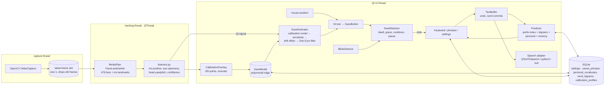

# Architecture

LookSay is a single-process PySide6 (Qt Widgets) app. Camera work runs on
background threads; everything the user sees runs on the Qt UI thread. All
data stays on the device.

## Modules

| Package | Responsibility | Key interfaces |
|---|---|---|
| `tracking/` | Camera capture, landmark detection, gaze features, smoothing, blink detection | `Frame`, `FaceFeatures`, `GazeSample`, `TrackingWorker.features_ready` |
| `calibration/` | Target layout, sample collection, model fitting and (de)serialisation | `CalibrationSession.fit() -> GazeModel`, `GazeModel.predict()` |
| `input/` | Dwell selection state machine; the message buffer | `DwellSelector.update(target, t, active, hold)`, `TextBuffer` |
| `prediction/` | Deterministic word prediction and personal learning | `Predictor.suggest(prefix, prev, n)`, `Predictor.learn(word, prev)` |
| `speech/` | Offline TTS adapters with a common protocol | `SpeechEngine` |
| `storage/` | SQLite with versioned migrations, settings with listeners, export/import/reset | `Database`, `Settings` |
| `i18n/` | EN / ES (Castilian) / CA strings and keyboard layouts | `tr(key, lang)`, `letter_rows()` |
| `diagnostics/` | FPS counters, dropped-frame and inference statistics | `TrackingStats`, `RateCounter` |
| `ui/` | Widgets, pages, overlays, theme, main window wiring | `GazeButton`, `MainWindow` |

## Design decisions

- **Gaze features, not pixels.** Per eye, the iris position is measured
  relative to the eye corners and eyelids and normalised by eye width, so it
  does not depend on distance to the camera. Head yaw and pitch are extra inputs. A
  2nd-order polynomial ridge regression (linear for 5 points) maps the features to
  0..1 window coordinates. It is fast (≈1.5 ms to fit), easy to inspect, and
  resizing the window does not invalidate it.
- **Confidence is a heuristic.** FaceLandmarker gives no per-frame score, so
  confidence combines face size, head rotation, eye openness and how plausible
  the iris position is. Below the user threshold, selection pauses and the cursor
  turns grey and dashed.
- **Drift.** Users can recentre explicitly (one dot). Auto drift correction
  can also nudge a bounded offset (max 8% of the window) towards the centre
  of each button selected by gaze.
- **Bounded frame queue.** The capture thread overwrites a size-1 slot, so
  analysis always uses the newest frame and memory stays flat. Dropped frames
  are counted and shown in Diagnostics. "Analyse every N frames" and a
  640 px inference width cap give extra CPU headroom.
- **Gaze-only UI.** Every control is a `GazeButton`. There are no sliders,
  combo boxes or scroll bars. Settings use ◀/▶ steppers, and long lists use
  pages. Confirmations are full-window overlays with the buttons far apart.
  While the app is paused, only "Resume" can be selected.
- **Caret at the end.** Editing works at the end of the message (character,
  word, undo). That covers composing and correcting a message without precise
  caret positioning, which is slow and error-prone by gaze.
- **Prediction.** 20k-word corpus frequencies plus a small curated AAC list
  (so "pain", "nurse" and "medicine" rank well), a seed-sentence bigram model,
  bounded personal counts (capped at 500 per word or pair, LRU-pruned tables),
  recency decay (3-day half-life), and accent-insensitive prefix matching
  ("medi" → "médico"). Ties are broken alphabetically, so the output is
  deterministic.

## Data

`settings(key, value)` · `saved_phrases(id, lang, text, is_emergency, position, created_at)` ·
`personal_vocabulary(lang, word, count, last_used)` · `word_bigrams(lang, prev, word, count, last_used)` ·
`calibration_profiles(id, name, created_at, version, n_points, screen_w, screen_h, error_px, model_json, active)`.

The version is tracked in `schema_version`. Migrations live in
`storage/database.py:MIGRATIONS`. If the database file is corrupt, it is moved
aside (`*.corrupt-<timestamp>`) and a new one is created. Bundled dictionaries
are read-only; personal learning is stored only in SQLite.

## Measured performance

From `python tools/benchmark.py` on a 4-vCPU Intel Xeon @ 2.8 GHz cloud VM
(Linux, Python 3.13, no GPU). Rerun it on your target hardware.

| Operation | median ms | p95 ms |
|---|---:|---:|
| Face + iris landmarks, 640×480 (MediaPipe, CPU) | 13.4 | 16.8 |
| Face + iris landmarks, 320×240 | 13.3 | 17.7 |
| Gaze features from landmarks | 0.06 | 0.13 |
| Gaze prediction (calibrated model) | 0.014 | 0.021 |
| Fit 9-point calibration (270 samples) | 1.5 | 2.6 |
| Dwell state update | 0.001 | 0.001 |
| Prefix suggestions (2 letters) | 0.17 | 0.32 |
| Prefix suggestions (single letter, worst case) | ≈4–10 | |
| Next-word suggestions | 0.08 | 0.16 |
| Load a language (20k words) | 70 | |

At ~13 ms per frame, analysis has headroom for 30 FPS on this CPU. The UI
loop ticks at 30 Hz (31.7 FPS measured in Diagnostics). On this VM the
benchmark process peaks at about 215 MB RSS. The PyInstaller folder build is
619 MB on Linux (≈167 MB xz-compressed). Most of that is `libmediapipe`
(122 MB), OpenCV (~200 MB) and Qt (~130 MB).

These numbers were not measured with a real webcam (the build VM has none), so
check the camera FPS and dropped-frame counts in Diagnostics on real hardware.
