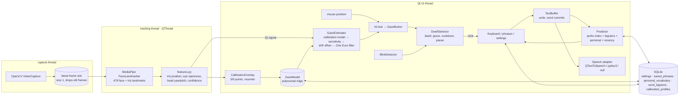

# Architecture

LookSay is a single-process PySide6 (Qt Widgets) app. Camera work runs on
background threads; everything the user sees runs on the Qt UI thread. All
data stays on the device.

## Modules

| Package | Responsibility | Key interfaces |
|---|---|---|
| `tracking/` | Camera capture, landmark detection, gaze features, smoothing, blink detection | `Frame`, `FaceFeatures`, `GazeSample`, `TrackingWorker.features_ready` |
| `calibration/` | Target layout, sample collection, model fitting and (de)serialisation | `CalibrationSession.fit() -> GazeModel`, `GazeModel.predict()` |
| `input/` | Dwell selection state machine; the message buffer | `DwellSelector.update(target, t, active, hold)`, `TextBuffer` |
| `prediction/` | Deterministic word prediction and personal learning | `Predictor.suggest(prefix, prev, n)`, `Predictor.learn(word, prev)` |
| `speech/` | Offline TTS adapters with a common protocol | `SpeechEngine` |
| `storage/` | SQLite with versioned migrations, settings with listeners, export/import/reset | `Database`, `Settings` |
| `i18n/` | EN / ES (Castilian) / CA strings and keyboard layouts | `tr(key, lang)`, `letter_rows()` |
| `diagnostics/` | FPS counters, dropped-frame and inference statistics | `TrackingStats`, `RateCounter` |
| `ui/` | Widgets, pages, overlays, theme, main window wiring | `GazeButton`, `MainWindow` |

## Design decisions

- **Gaze features, not pixels.** Each frame gives a 13-value feature vector:
  - per eye, the iris centre (mean of the 5 iris landmarks) relative to the
    centroid of the 16-point eye contour, in an eye-aligned frame (head roll
    removed) and normalised by eye width;
  - the eyelid aperture, because the upper lid follows vertical gaze, which
    is where webcam iris landmarks are weakest;
  - MediaPipe's eyeLook blendshapes, a second, learned estimate of eye
    rotation;
  - the 3D head pose (yaw, pitch, roll and translation in cm) from
    MediaPipe's facial transformation matrix.
  Blendshapes and pose cost nothing measurable, and full-resolution frames
  (up to 1280 px wide) cost the same as 640 px because iris landmarks are
  computed on eye crops.
- **Calibration model.** Ridge regression on standardised features, plus
  quadratic terms of the combined eye signals when there are 8 or more
  points. The ridge strength is chosen by leave-one-point-out
  cross-validation, and that cross-validated error is the accuracy shown to
  the user. It is more honest than the training error. The result screen
  draws each target and where the model placed the gaze. 5, 9 and 13 points
  are available.
- **Pointer fusion (eyes + nose).** The head cue is the nose tip relative to
  the face outline (plus 3D yaw and pitch). It moves when the head turns or
  tilts, not when the head shifts. In the default eyes+nose mode the cursor
  jumps to the gaze point when the gaze is more than 10% of the window away
  for 120 ms. Otherwise it stays anchored, and head movement since the jump
  moves it at half the head-pointer gain. Eyes give speed, the head gives
  precision ("gaze + head pinpointing"). The nose-only mode uses a 5- or
  9-point "point your nose at the dot" ridge calibration with
  leave-one-point-out error, like the eye model.
- **Fixation stabiliser.** After the One Euro filter, a dispersion-based
  (I-DT style) window holds the cursor at the mean while the gaze stays
  within 3% of the window for 0.3 s. A saccade resets it immediately. This
  makes dwell selection much steadier without adding lag to large moves.
- **Optional iris refinement.** A darkness-weighted centroid inside the
  predicted iris circle, masked by the eye contour, is blended 50/50 with
  the landmark centre. The shift is capped at 0.6 iris radii. It is off by
  default because glasses reflections can mislead it; compare both in the
  K view.
- **Confidence is a heuristic.** FaceLandmarker gives no per-frame score, so
  confidence combines face size, head rotation, eye openness, whether the
  iris is plausibly inside the eye, and whether both eyes agree. Below the
  user threshold, selection pauses and the cursor turns grey and dashed.
- **Debug view (K).** The worker renders a face crop (mesh, eye contours,
  iris circles, eye-direction arrows, head-pose axes) and two roll-corrected,
  magnified eye views (contour, corners, eye centre, iris circle,
  landmark-only versus refined centre, scale bar), at 20 Hz and only while
  the view is open. The UI adds HUD lines with every value the pipeline
  uses.
- **Drift.** Users can recentre explicitly (one dot). Auto drift correction
  can also nudge a bounded offset (max 8% of the window) towards the centre
  of each button selected by gaze.
- **Bounded frame queue.** The capture thread overwrites a size-1 slot, so
  analysis always uses the newest frame and memory stays flat. Dropped frames
  are counted and shown in Diagnostics. "Analyse every N frames" and a
  640 px inference width cap give extra CPU headroom.
- **Gaze-only UI.** Every control is a `GazeButton`. There are no sliders,
  combo boxes or scroll bars. Settings use ◀/▶ steppers, and long lists use
  pages. Confirmations are full-window overlays with the buttons far apart.
  While the app is paused, only "Resume" can be selected.
- **Caret at the end.** Editing works at the end of the message (character,
  word, undo). That covers composing and correcting a message without precise
  caret positioning, which is slow and error-prone by gaze.
- **Prediction.** 20k-word corpus frequencies plus a small curated AAC list
  (so "pain", "nurse" and "medicine" rank well), a seed-sentence bigram model,
  bounded personal counts (capped at 500 per word or pair, LRU-pruned tables),
  recency decay (3-day half-life), and accent-insensitive prefix matching
  ("medi" → "médico"). Ties are broken alphabetically, so the output is
  deterministic.

## Data

`settings(key, value)` · `saved_phrases(id, lang, text, is_emergency, position, created_at)` ·
`personal_vocabulary(lang, word, count, last_used)` · `word_bigrams(lang, prev, word, count, last_used)` ·
`calibration_profiles(id, name, created_at, version, n_points, screen_w, screen_h, error_px, model_json, active)`.

The version is tracked in `schema_version`. Migrations live in
`storage/database.py:MIGRATIONS`. If the database file is corrupt, it is moved
aside (`*.corrupt-<timestamp>`) and a new one is created. Bundled dictionaries
are read-only; personal learning is stored only in SQLite.

## Measured performance

From `python tools/benchmark.py` on a 4-vCPU Intel Xeon @ 2.8 GHz cloud VM
(Linux, Python 3.13, no GPU). Rerun it on your target hardware.

| Operation | median ms | p95 ms |
|---|---:|---:|
| Face + iris landmarks + blendshapes + pose, 1280×960 (MediaPipe, CPU) | 11.3 | 15.8 |
| Same at 640×480 | 10.1 | 13.3 |
| Gaze features (landmarks + pose + blendshapes) | 0.20 | 0.29 |
| Iris refinement, both eyes (optional) | 0.69 | 0.93 |
| Debug views render (only while K view is open) | 2.5 | 3.2 |
| Gaze prediction (calibrated model) | 0.021 | 0.032 |
| Fit 9-point calibration with cross-validation | 8.2 | 10.2 |
| Dwell state update | 0.001 | 0.001 |
| Prefix suggestions (2 letters) | 0.17 | 0.22 |
| Next-word suggestions | 0.07 | 0.11 |
| Load a language (20k words) | 64 | |

At ~11 ms per frame, analysis has headroom for 30 FPS on this CPU. The UI
loop ticks at 30 Hz (31.7 FPS measured in Diagnostics). On this VM the
benchmark process peaks at about 215 MB RSS. The PyInstaller folder build is
619 MB on Linux (≈167 MB xz-compressed). Most of that is `libmediapipe`
(122 MB), OpenCV (~200 MB) and Qt (~130 MB).

These numbers were not measured with a real webcam (the build VM has none), so
check the camera FPS and dropped-frame counts in Diagnostics on real hardware.
